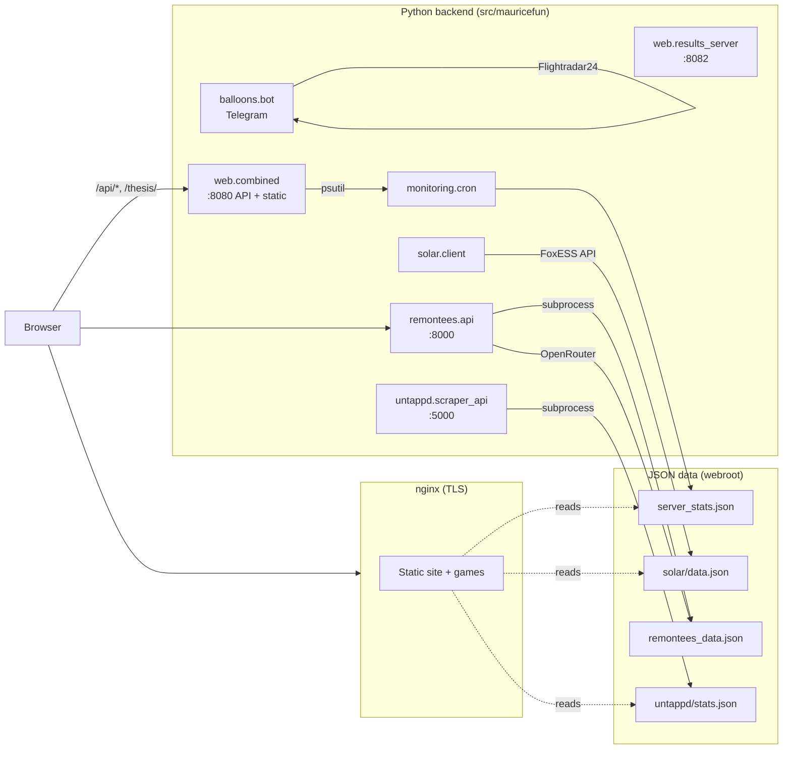

# VPS_Coding — mauricefun.lol

[](https://github.com/MauriceBa/VPS_Coding/actions/workflows/ci.yml)
[](LICENSE)
[](https://www.python.org/)
[](https://github.com/astral-sh/ruff)

Monorepo powering **[mauricefun.lol](https://mauricefun.lol)** — a personal website, a collection of
browser games, and a small Python backend (monitoring, scrapers, solar data and a Telegram bot).

Everything runs from a single repository: static sites are served by **nginx**, while the Python
services run as **systemd** units and write their JSON output into the nginx webroot.

## Overview

The repository mixes two clearly separated concerns:

- **Static front end** — HTML/CSS/JS sites and browser games served directly by nginx. Client-side
  game logic is organised into ES modules with unit tests.
- **Python backend** (`src/mauricefun/`) — a typed, tested package that collects host metrics,
  exposes a monitoring API, proxies Streamlit, scrapes ski-forum and Untappd data, fetches FoxESS
  solar readings, and runs a Telegram hot-air-balloon tracker.

## Core features

- 📊 **Live host dashboard** — CPU (total + per-core), RAM and network throughput with `1m` / `1h` /
  `24h` history, served over a dependency-light `http.server`.
- 🔁 **Streamlit reverse proxy** — `/thesis/` is proxied with full WebSocket tunnelling.
- ☀️ **Solar monitoring** — FoxESS inverter client with signed requests, cached for the dashboard.
- 🎿 **Remontées scraper** — scrapes ski-resort/lift news and attaches LLM summaries via OpenRouter.
- 🍺 **Untappd analytics** — parses personal exports, geocodes venues, and runs a content-based
  recommendation pipeline.
- 🎈 **Balloon tracker** — Telegram bot that polls Flightradar24, detects balloons, and reports
  distance/direction statistics.
- 🎮 **Browser games** — Planetski, SkiTycoon, Game Bridle and more, modularised into tested ES
  modules.

## Architecture



## Repository layout

```
.
├── src/mauricefun/          # Python backend package (typed, tested)
│   ├── config.py            # environment-driven Settings
│   ├── logging_config.py    # structured logging setup
│   ├── exceptions.py        # custom exception hierarchy
│   ├── monitoring/          # metrics, history buffer, stats cron job
│   ├── web/                 # combined server, Flask API, results server, proxy
│   ├── solar/               # FoxESS client
│   ├── remontees/           # forum scraper + FastAPI wrapper
│   ├── untappd/             # export parser, scraper, locations, recommender
│   └── balloons/            # geo, detector, stats, Telegram bot
├── tests/                   # pytest suite (Python)
├── tests/js/                # vitest suite (JavaScript)
├── systemd/                 # reference systemd units
├── config/nginx-site.conf   # nginx site configuration
├── deploy.sh                # one-shot static-site deployment
├── games/                   # browser games
├── ballons/  btd6/  beer/  beer-style-explorer/  energy-clicker/  ...
├── remontees/  solar/  untappd/  slopes/  planetski/  SkiTycoon/
└── server.py  stats_app.py  results_server.py  # backward-compatible shims
```

The original script paths (`server.py`, `scripts/fetch_solar.py`, `untappd/scripts/*.py`, …) are
kept as thin **shims** that call into the package, so cron jobs and systemd units keep working.

## Quickstart & installation

### Prerequisites

- Python **3.10+**
- Node.js **20+** (only for the JavaScript tooling)
- A Linux host for the metric/cron features (they read `/proc`)

### Python backend

```bash
git clone https://github.com/MauriceBa/VPS_Coding.git
cd VPS_Coding

python -m venv .venv
source .venv/bin/activate          # Windows: .venv\Scripts\activate

# Install the package with the services you need
pip install -e ".[dev,monitoring,remontees,untappd]"

cp .env.example .env               # then fill in secrets
```

### JavaScript tooling

```bash
npm install
```

## Configuration

All configuration is read from environment variables (see [`.env.example`](.env.example)); nothing is
hardcoded. Key variables:

| Variable | Purpose |
|----------|---------|
| `FOXESS_API_KEY`, `FOXESS_DEVICE_SN` | FoxESS solar API credentials |
| `OPENROUTER_API_KEY` | LLM summaries for the Remontées scraper |
| `TELEGRAM_BOT_TOKEN` | Telegram balloon tracker |
| `WEB_ROOT`, `DATA_DIR`, `RESULTS_DIR` | Filesystem paths |
| `STATS_HOST`, `STATS_PORT`, `STREAMLIT_URL` | Monitoring server |

## Usage examples

Run any service as a module or via its console script:

```bash
# Combined static + monitoring API on :8080
python -m mauricefun.web.combined
# or: mauricefun-monitoring

# Results static server on :8082
python -m mauricefun.web.results_server

# Fetch solar data once (writes solar/data.json)
python -m mauricefun.solar.client

# Scrape the ski forum (posts per thread)
python -m mauricefun.remontees.scraper 40

# Parse an Untappd export and regenerate stats.json
python -m mauricefun.untappd.parser untappd/data/untapped_maurice.txt

# Run the Telegram balloon tracker
python -m mauricefun.balloons.bot
```

The legacy entrypoints still work: `python server.py`, `python scripts/fetch_solar.py`, etc.

## Testing

```bash
# Python: lint, format, types, tests
ruff check .
ruff format --check .
mypy
pytest --cov=mauricefun

# JavaScript: lint, format, tests
npm run lint
npm run format:check
npm run test
```

## Deployment

```bash
git pull
./deploy.sh          # syncs the static site, links games, reloads nginx
```

Backend services are managed with the units in [`systemd/`](systemd/) — see
[`systemd/README.md`](systemd/README.md) for installation.

## Contributing & License

See [CONTRIBUTING.md](CONTRIBUTING.md) for local setup, branch naming and commit conventions, and
[SECURITY.md](SECURITY.md) for reporting vulnerabilities. Released under the [MIT License](LICENSE).
